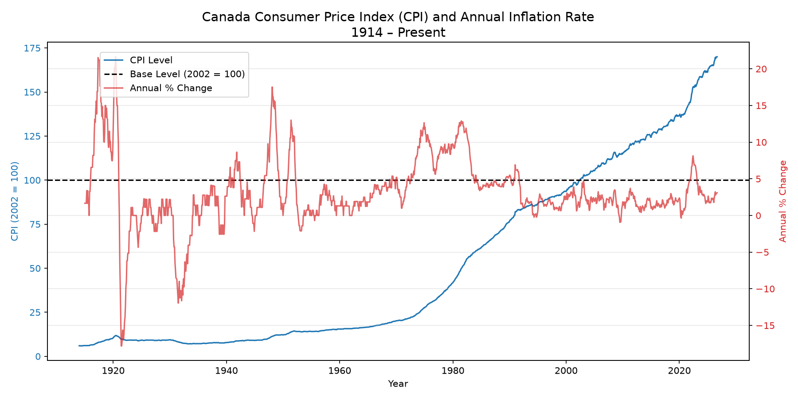

# FINE 3300 Assignment 2 – Consumer Price Index & Inflation Calculator

Student: Abigail Rodrigues  (220400172)  
Course: FINE 3300 – Python for Finance Professionals  
Term: Fall 2026

## Introduction
Below is my replication of the Bank of Canada Consumer Price Index (CPI) calculator. This project uses monthly CPI data from the Bank of Canada over the past years, to create a graph and an inflation calculator.
Users will be able to decipher the cost of a basket of goods and services in certain years, along with other information such as Percent change, Number of years, Average annual rate of inflation (%) / Decline in the value of money, CPI for the first year, and the CPI for the second year.

This calculator enhances the original by allowing the user to insert both year and month to calculate.

## Files in this repository
- `cpi_calculator.py` – this is the main Python program
- `cpi_data.csv` – this is the monthly CPI data which was downloaded from the Bank of Canada website
- `cpi_graph.png` – this is the graph created by the program
- `README.md` – this file which details pertinent information

## How to run the project
1. Make sure that you have Python installed
2. Make sure to also install the required libraries (if needed):
pip install pandas matplotlib numpy

3. Make sure `cpi_data.csv` is in the same folder as the Python file
4. Run the program:

python3 cpi_calculator.py

## CPI Graph

### Short commentary on the CPI
The blue line on the graph shows the Consumer Price Index level (2002 = 100).  
The red line on the graph shows the year-over-year percentage change (annual inflation).  
The black dotted line on the graph marks the base level of 100.

Some interesting points to note:
- Prices were very low in the early 1900s.
- There was high inflation during the 1970s and early 1980s.
- Inflation stayed relatively low and stable for many years after the mid-1990s.
- There was a clear rise in inflation after 2021.
- The most recent data (2026) shows inflation moving closer to the Bank of Canada’s 2% target.

## Example of a Calculator Output

Bank of Canada Style Inflation Calculator

Enter the price of the goods/services (example: 100 or 49.99): $100

Enter the first date (format YYYY-MM, example: 2000-09): 2000-09

Enter the second date (format YYYY-MM, example: 2024-06): 2020-09

Results

$100.00 in 2000-09 is equivalent to $142.46 in 2020-09

Percentage change:          +42.46%

Difference in years:        20.0 years

Average annual rate:        1.79%

CPI in 2000-09:               96.1

CPI in 2020-09:               136.9

(All money values rounded to the nearest penny)

(Original entered price of goods or service must be positive, else user will be prompted again to insert a positive number)

## Data Source
Bank of Canada Valet API  
https://www.bankofcanada.ca/valet/observations/STATIC_INFLATIONCALC/csv  

Original series: Statistics Canada V41690973 (Total CPI, 2002 = 100)
